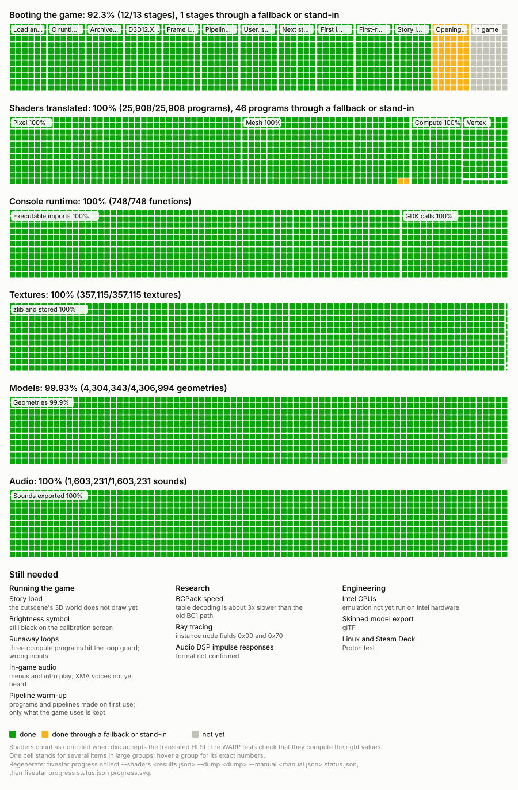

# Status

GTA VI does not run yet. Updated 27 November 2026.

## Where it is

- **Boots to the world.** Logo, intro, first-run screens, story load and the opening scenes run; the start-up freeze
  is fixed.
- **Picture, by stage** (read from one frame's intermediate images, `--dump-frame`):
  - Geometry, normals, depth: right.
  - Surface colour: right for most surfaces since textures the game still uses are no longer retired by their
    neighbours. Characters and clothing draw when the skinned passes are not skipped. Open: hair, vehicle bodies,
    some odd colours.
  - Lighting: writes almost nothing, so the final frame is dark or blown out. The tiled lighting pass draws every
    tile, but its depth-equal test rejects almost all pixels (with the test forced to "always" the whole frame is
    shaded). Why the test fails is open.
  - Exposure: follows the black lighting to its floor.
- **Device loss:** about 10 minutes in, at the same point of the game. Not a plain GPU timeout as written here
  before: the queues still finish work 0.3 s before the loss, the removal reason is DEVICE_REMOVED, Windows records
  no timeout for most losses, and turning the queue timeout off (`--no-gpu-timeout`) changes nothing. Traced in two
  boots: the NVIDIA user-mode driver fails inside `ExecuteCommandLists` of a game submission and gives the device up
  itself; no kernel call fails first and no GPU fault is reported. Which list it rejects, or what it runs out of, is
  the next boot.
- **Speed:** a world frame takes about 200-400 ms. Targets: 30 fps, then 60.
- **AMD:** world geometry draws since #55.

## Known problems

| Problem | Next step |
|---|---|
| Lighting pass shades almost no pixels | find why its depth-equal test fails; then directional light and ambient inputs |
| Device removed about 10 minutes in | find which component removes it (Windows, driver or a failed call of ours) |
| Hair and vehicle bodies missing from surface colour | bring back the remaining skipped skinned passes one by one |
| GPU writes to game memory in system RAM are slow | wide stores (next batch); video-memory copies |
| Ray tracing | not built; those passes are held and stand-ins fill some outputs |

## Components

| Area | Result |
|---|---|
| Shaders | all 25,908 native programs translate and compile to DXIL; our own DXIL backend, dxc as fallback |
| Shader cache | a re-run with nothing changed takes 26 s instead of about 70 minutes |
| Driver pipelines | about 3,850 pipelines warm up in about 35 minutes; ray-tracing ones are skipped |
| Mesh fallback | all 8,765 mesh programs also build as compute plus vertex pulling, for GPUs without mesh shaders |
| Translator checks | 520 shader tests, most on D3D12 WARP; the RDNA decoder matches LLVM on all 44 million instructions |
| Archives | about 68% of archive bytes extract; file names unknown |
| Textures | all 357,115 export exactly with the user's BCPack tables (99.44% without) |
| Models | 99.94% of 4.3 million geometries decode; OBJ export |
| Videos | 515 Bink 2 videos extract |
| Audio | all 1,603,231 sounds export (Opus, XMA2, PCM); XMA2 decoder matches FFmpeg |
| Executable | all 587 imports resolved; the six Xbox libraries load |
| Console runtime | 161 GDK functions shimmed; saves, user and store work offline |
| Graphics (D3D12.X) | every console object wraps a desktop one; console-only methods are logged |
| Setup | `fivestar setup` prepares a dump in one resumable command |

Details per area: [Roadmap](Roadmap.md).
